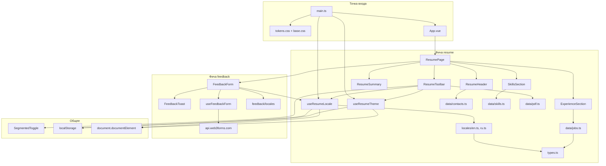
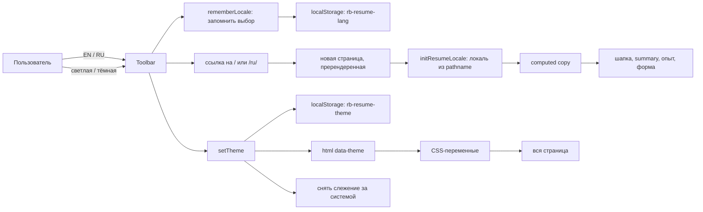

# CV

[](https://app.netlify.com/projects/roman-barakhvostov-cv/deploys)

Приложение: [https://roman-barakhvostov-cv.netlify.app/](https://roman-barakhvostov-cv.netlify.app/)

Приложение-резюме: шапка с именем, ролью и контактами, краткое summary, опыт работы, навыки, скачивание PDF и форма обратной связи — на английском (`/`) и русском (`/ru/`).

Обе страницы **пререндерятся в статический HTML при сборке**, поэтому текст резюме виден поисковику и генераторам превью без исполнения JS.

Стек: **Vue 3.5** (Composition API, `<script setup>`), **TypeScript** (strict), **Vite 8**. Состояние локали и темы живёт в composable-ах, данные резюме — в статичных модулях, UI собран по фичам `resume` и `feedback`.

## Что умеет страница

- две языковые версии на отдельных URL: `/` — английская, `/ru/` — русская. Переключатель — обычные ссылки, поэтому работают «назад» и «открыть в новой вкладке»;
- светлая и тёмная тема (`html[data-theme]`);
- при первом заходе тема берётся из `prefers-color-scheme`, иначе `dark`. Пока её не выбрали вручную, она продолжает следовать смене системной; явный выбор отключает слежение;
- при первом заходе на `/` язык берётся из `navigator.languages`: русскоязычный браузер уводится на `/ru/`. Как только выбор сделан явно, решает он — клик по EN отключает автоопределение навсегда;
- тема и **явно выбранный** язык сохраняются в `localStorage`. Предпочтением считается только клик по переключателю: открытие `/ru/` по чужой ссылке ничего не записывает, иначе дорога к английской версии закрылась бы;
- скачивание PDF-версии резюме под текущий язык;
- контакты, опыт работы и список навыков;
- форма обратной связи: имя и сообщение уходят на почту через [Web3Forms](https://web3forms.com/), успех и ошибки доставки показываются тостом.

## Аналитика

Посещаемость считает [GoatCounter](https://www.goatcounter.com/). Дашборд — `https://rbarakhvostov.goatcounter.com`, доступ по паролю владельца; на самой странице счётчик никак не отображается.

Подключение — один тег в конце `<body>` в [`index.html`](index.html): версионированный `count.v5.js` с `integrity` (SRI), чтобы сторонний скрипт не мог молча измениться. Ни кода, ни env-переменных, ни зависимостей в `package.json` это не добавляет — код сайта в URL публичен по своей природе и прячется только в разметке.

| Вопрос                | Ответ                                                                                                                  |
| --------------------- | ---------------------------------------------------------------------------------------------------------------------- |
| Cookies, localStorage | не используются, персональные данные не собираются — баннер согласия не нужен                                          |
| Локальная разработка  | `localhost` и приватные подсети count.js отсекает сам, дев-заходы в статистику не попадают                             |
| Свои визиты           | один раз открыть `https://roman-barakhvostov-cv.netlify.app/#toggle-goatcounter` в каждом своём браузере               |
| Точность              | блокировщики рекламы режут `gc.zgo.at`, поэтому реальные цифры выше показанных; тренды и источники трафика не страдают |

Раз в год стоит заглянуть на [список версий count.js](https://www.goatcounter.com/code/countjs-versions): при выходе новой версии URL и `integrity` обновляются вместе.

## SEO

Страница должна находиться по имени и по профессиональным запросам, а одностраничному приложению краулер по умолчанию видит пустой `<div id="app">`. Поэтому:

| Что                 | Где                                                                                        |
| ------------------- | ------------------------------------------------------------------------------------------ |
| Пререндер в HTML    | [`vite/prerender.ts`](vite/prerender.ts) + [`src/entry-server.ts`](src/entry-server.ts)    |
| Две языковые версии | `/` и `/ru/`, связаны `hreflang` (`en`, `ru`, `x-default`), у каждой свой `canonical`      |
| Мета-теги           | `src/features/resume/utils/buildHead.ts` — title, description, Open Graph, Twitter, шрифты |
| Schema.org          | `src/features/resume/utils/buildJsonLd.ts` — `ProfilePage` + `Person` + `WebSite`          |
| Домен и тексты      | `src/features/resume/data/seo.ts` — `SITE_URL`, заголовки и описания по локалям            |
| Карта сайта         | `dist/sitemap.xml` генерируется при сборке, `public/robots.txt` на неё ссылается           |
| Превью ссылок       | `public/og-image.png` (1200×630), генерируется `node scripts/build-og-image.mjs`           |
| Шрифты              | Inter лежит в `public/fonts/`, а не на `fonts.googleapis.com` — минус блокирующий запрос   |

JSON-LD собирается из тех же модулей `data/` и `locales/`, что и сама страница, поэтому разметка не может разойтись с видимым текстом.

Переезд на свой домен — одна строка: `SITE_URL` в `src/features/resume/data/seo.ts` (плюс 301 со старого адреса в Netlify).

### Что нужно сделать руками

1. Сверить в UI Netlify (Site configuration → Build & deploy), что команда сборки и каталог публикации совпадают с [`netlify.toml`](netlify.toml): `npm run build` и `dist`. При расхождении выигрывает файл — настройки сборки теперь живут в репозитории.
   SPA-fallback `/* → /index.html` пререндеренному сайту противопоказан: у него есть настоящие файлы, а fallback вернул бы 200 с английской страницей на любой опечаточный URL (soft 404 и дубли) и в `force`-варианте сломал бы `/ru/`.

   Слэш в конце `/ru/` ставит встроенная Pretty URLs, включённая по умолчанию. Правилом редиректа этого делать нельзя: CDN нормализует путь **до** сопоставления, поэтому `from = "/ru"` совпадёт и с `/ru/` — выйдет бесконечный редирект ([документация](https://docs.netlify.com/manage/routing/redirects/redirect-options/)). Локальный `npm run preview` такое не ловит: у него свой SPA-фолбэк, из-за которого любой путь отдаёт 200.

2. Добавить сайт в Google Search Console и Яндекс.Вебмастер, отправить `sitemap.xml`.
3. Поставить ссылку на сайт в LinkedIn, GitHub, Telegram и профилях на job-бордах — внешние ссылки единственное, что нельзя сделать кодом.

### Обновление OG-картинки

```sh
node scripts/build-og-image.mjs
```

Рендерит `public/og-image.png` и `public/apple-touch-icon.png` через headless Chrome; результат коммитится. В сборку скрипт не входит — ни Chrome, ни новых зависимостей на CI и Netlify не требуется. Запускать при смене имени, роли или палитры.

## Стек

| Слой     | Выбор                                           |
| -------- | ----------------------------------------------- |
| UI       | Vue 3 SFC, Composition API                      |
| Типы     | TypeScript + `vue-tsc --build`                  |
| Сборка   | Vite, алиас `@` → `src`                         |
| Тесты    | Vitest + Vue Test Utils                         |
| Качество | ESLint, Stylelint, Prettier, Husky, lint-staged |
| Почта    | Web3Forms, `fetch` + `FormData`                 |

Роутера и Pinia нет: две языковые версии — это два статических файла, которые Netlify отдаёт напрямую, а локаль приложение узнаёт из `location.pathname`. Сетевой запрос один: форма шлёт `FormData` через `fetch`.

## Как устроено приложение

Код растёт **по фичам**, а не по типу файлов. Общие презентационные компоненты лежат в `src/components/`, резюме — в `src/features/resume/`, форма — в `src/features/feedback/`.

```
src/
├── main.ts                      # bootstrap: тема, локаль, mount
├── App.vue                      # рендерит только ResumePage
├── assets/styles/               # токены и глобальный CSS
├── components/                  # общие UI-примитивы
│   └── SegmentedToggle.vue
└── features/
    ├── resume/
    │   ├── types.ts             # Locale, Theme, ResumeCopy, JobMeta
    │   ├── composables/         # локаль и тема
    │   ├── data/                # контакты, вакансии, навыки, PDF
    │   ├── locales/             # тексты EN / RU
    │   ├── ui/                  # секции страницы
    │   └── utils/               # чистые функции без Vue API
    └── feedback/
        ├── types.ts             # статус, ошибки, тост, ответ API
        ├── composables/         # useFeedbackForm
        ├── data/                # сборка FormData для Web3Forms
        ├── locales/             # тексты формы EN / RU
        ├── ui/                  # FeedbackForm, FeedbackToast
        └── utils/               # validateFeedback
```

### Схема слоёв



### Как данные доходят до экрана

1. Браузер получает уже готовый HTML: нужная локаль, `html[lang]`, мета-теги и весь текст резюме проставлены при сборке (см. [SEO](#seo)).
2. До первой отрисовки инлайн-скрипт в [`index.html`](index.html) ставит `data-theme` (правила те же, что в `useResumeTheme`) и решает, остаётся ли посетитель на корне: `main.ts` — отложенный модуль, без скрипта страница мигнула бы тёмной и английской. Уводит он только с `/` — по сохранённому выбору либо, если выбора ещё не было, по языку браузера.
3. `main.ts` вызывает `initResumeLocale()` (читает локаль из `location.pathname`, ничего не сохраняя) → гидратирует приложение → **и только потом** `initResumeTheme()`. Порядок важен: тема известна лишь на клиенте, а Vue при гидратации не переприменяет `class`, поэтому до `mount` её выставлять нельзя — переключатель остался бы подсвеченным неверно.
4. `App.vue` монтирует `ResumePage` — единственный экран.
5. `ResumePage` берёт `copy` из `useResumeLocale` и раздаёт его секциям пропсами. Форма сама читает локаль и берёт тексты из `features/feedback/locales`.
6. Метаданные (компании, периоды, ссылки, ключи ролей) лежат в `data/`. Переводимые строки — в `locales/`. Секция опыта склеивает их: `copy.jobs[job.id]` и `copy[job.roleKey]`.
7. Тема не прокидывается пропсами: `useResumeTheme` ставит `data-theme` на `<html>`, а цвета берутся из CSS-переменных в `tokens.css` — включая подсветку самого переключателя темы: пререндеренная разметка всегда «тёмная», поэтому пилюлю рисует селектор по `html[data-theme]`, а не класс `.is-on`.



### Состояние без Pinia

`locale` и `theme` — модульные `ref` внутри composable-ов. Все вызовы `useResumeLocale()` / `useResumeTheme()` видят один и тот же экземпляр. Этого достаточно: состояние глобальное, но крошечное, и его не нужно кэшировать как серверные данные.

| Composable        | Ключ storage      | Побочный эффект                                                                                     |
| ----------------- | ----------------- | --------------------------------------------------------------------------------------------------- |
| `useResumeLocale` | `rb-resume-lang`  | нет: локаль приходит из URL, `html[lang]` ставит пререндер; в storage пишет только `rememberLocale` |
| `useResumeTheme`  | `rb-resume-theme` | `html[data-theme]`, слежение за `prefers-color-scheme`                                              |

Чтение и запись `localStorage` обёрнуты в `try/catch`. Если хранилище недоступно (приватный режим), сохранённого выбора нет, и снова работают системные настройки. `en` и `dark` остаются только когда нет ни хранилища, ни `navigator` / `matchMedia`.

Явный `setTheme` записывает выбор и снимает подписку на системную тему. Функции `setLocale` больше нет: язык меняется переходом по ссылке. Выбор записывает `rememberLocale` по событию `select` переключателя, а `initResumeLocale` только читает URL. Разделение принципиальное: если бы предпочтение записывалось при открытии страницы, заход на `/ru/` заблокировал бы английскую версию — инлайн-скрипт уводил бы с `/` раньше, чем отложенный `main.ts` успел бы записать `en`.

### Почему данные разделены

| Источник                         | Что хранит                                           | Почему отдельно                    |
| -------------------------------- | ---------------------------------------------------- | ---------------------------------- |
| `locales/en.ts`, `locales/ru.ts` | имя, summary, заголовки, буллеты опыта, подписи темы | меняется с языком                  |
| `data/jobs.ts`                   | id компании, период, URL, `roleKey`                  | одно и то же на обоих языках       |
| `data/contacts.ts`               | mailto, Telegram, LinkedIn, GitHub                   | не зависит от локали               |
| `data/skills.ts`                 | чипы навыков                                         | названия технологий не переводятся |
| `data/pdf.ts`                    | путь и имя файла PDF                                 | разные файлы для EN и RU           |
| `feedback/locales/`              | подписи, ошибки и тексты тостов формы                | меняется с языком резюме           |

Типы в `types.ts` связывают эти слои: `JobId` и `RoleKey` не дают сослаться на несуществующую вакансию или роль.

## Обратная связь

Секция внизу `ResumePage`. Тексты формы живут отдельно от резюме и переключаются той же локалью.

Отправка — `POST` на `https://api.web3forms.com/submit`. Тело собирает `buildWeb3FormsFormData` как `FormData`: `multipart/form-data` входит в safelist CORS, и браузер отправляет запрос сразу, без preflight `OPTIONS`. В части WebView (встроенный браузер Telegram на iOS) такой preflight обрывается и выглядит как ошибка сети.

Ключ доступа — `VITE_WEB3FORMS_ACCESS_KEY`. Шаблон лежит в [`.env.example`](.env.example): скопируйте его в `.env` и подставьте ключ из дашборда Web3Forms. Файл `.env` в git не попадает. Ключ попадает в клиентский бандл; Web3Forms ограничивает его списком доменов. Локально без ключа отправка не уходит, тост предлагает написать на почту напрямую.

Поведение формы:

- пустые имя или сообщение подсвечиваются под полем; ошибка снимается, как только поле снова валидно, и до следующей отправки новые ошибки не ставятся;
- успех, сетевая ошибка, ответ сервера и отсутствующий ключ показываются тостом (`FeedbackToast`). У ошибок доставки в тосте есть ссылка `mailto`;
- скрытый чекбокс-honeypot: если он отмечен, форма делает вид, что сообщение ушло, и запрос не отправляет.

## Запуск

Нужен Node.js `^22.18.0` или `>=24.12.0`.

```sh
npm install
cp .env.example .env
npm run dev
```

В `.env` замените `VITE_WEB3FORMS_ACCESS_KEY` на ключ Web3Forms и добавьте домен в allow-list ключа. Без ключа страница открывается, форма при отправке показывает ошибку конфигурации.

Сборка и предпросмотр:

```sh
npm run build
npm run preview
```

## Проверки

```sh
npm run format
npm run lint
npm run lint:css
npm run type-check
npm run test
```

Тесты:

| Скрипт                  | Что делает                                  |
| ----------------------- | ------------------------------------------- |
| `npm test`              | один прогон (`vitest run`)                  |
| `npm run test:watch`    | watch-режим                                 |
| `npm run test:coverage` | прогон с покрытием (терминал + `coverage/`) |

Перед коммитом Husky запускает:

1. **lint-staged** — только по staged-файлам: Prettier для всех, Stylelint для CSS/Vue, ESLint для TypeScript/Vue;
2. **`npm run type-check`** — весь проект (`vue-tsc --build`);
3. **`npm test`** — весь сьют.

Type-check и тесты специально не в lint-staged: это проверки всего проекта, а не отдельных путей.

ESLint дополнительно требует стрелочные функции и пустую строку до и после `if` / `for`, а также перед каждым `return`.

## Как править контент

- тексты резюме — `src/features/resume/locales/en.ts` и `ru.ts`;
- места работы — `src/features/resume/data/jobs.ts` (и буллеты в локалях под тем же `JobId`);
- контакты — `src/features/resume/data/contacts.ts`;
- навыки — `src/features/resume/data/skills.ts`;
- PDF — файлы в `public/uploads/`, пути в `src/features/resume/data/pdf.ts`;
- тексты формы обратной связи — `src/features/feedback/locales/en.ts` и `ru.ts`.

Новую вакансию добавляйте сразу в три места: `JobId` в `types.ts`, объект в `jobs.ts`, массив буллетов в обеих локалях.

## IDE

[VS Code](https://code.visualstudio.com/) + [Vue (Official)](https://marketplace.visualstudio.com/items?itemName=Vue.volar). Vetur лучше отключить.
