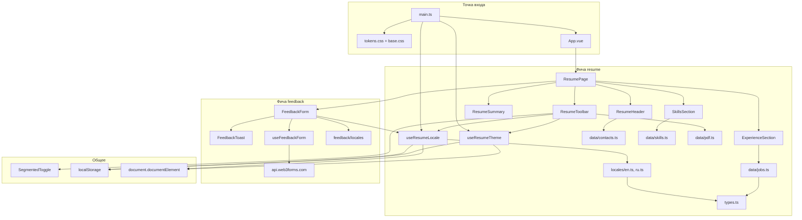
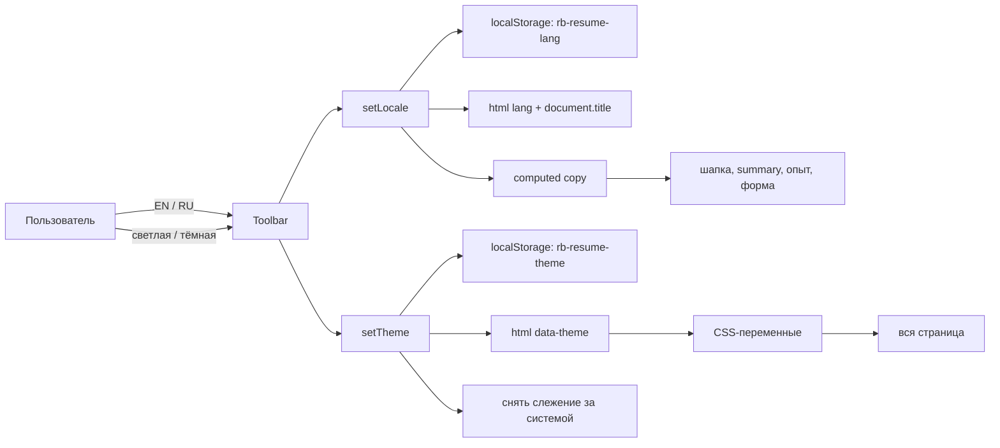

# CV

[](https://app.netlify.com/projects/roman-barakhvostov-cv/deploys)

Приложение: [https://roman-barakhvostov-cv.netlify.app/](https://roman-barakhvostov-cv.netlify.app/)

Одностраничное приложение-резюме: шапка с именем, ролью и контактами, краткое summary, опыт работы, навыки, скачивание PDF и форма обратной связи — на английском и русском.

Стек: **Vue 3.5** (Composition API, `<script setup>`), **TypeScript** (strict), **Vite 8**. Состояние локали и темы живёт в composable-ах, данные резюме — в статичных модулях, UI собран по фичам `resume` и `feedback`.

## Что умеет страница

- переключение языка **EN / RU** (тексты, `document.title`, `html[lang]`);
- светлая и тёмная тема (`html[data-theme]`);
- при первом заходе язык и тема берутся из системы: `navigator.languages` и `prefers-color-scheme`. Если система ничего подходящего не даёт — `en` и `dark`. Пока тему не выбрали вручную, она продолжает следовать смене `prefers-color-scheme`; явный выбор отключает это слежение;
- оба выбора после переключения сохраняются в `localStorage` и поднимаются при следующем заходе;
- скачивание PDF-версии резюме под текущий язык;
- контакты, опыт работы и список навыков;
- форма обратной связи: имя и сообщение уходят на почту через [Web3Forms](https://web3forms.com/), успех и ошибки доставки показываются тостом.

## Аналитика

Посещаемость считает [GoatCounter](https://www.goatcounter.com/). Дашборд — `https://rbarakhvostov.goatcounter.com`, доступ по паролю владельца; на самой странице счётчик никак не отображается.

Подключение — один тег в конце `<body>` в [`index.html`](index.html): версионированный `count.v5.js` с `integrity` (SRI), чтобы сторонний скрипт не мог молча измениться. Ни кода, ни env-переменных, ни зависимостей в `package.json` это не добавляет — код сайта в URL публичен по своей природе и прячется только в разметке.

| Вопрос                | Ответ                                                                                                                  |
| --------------------- | ---------------------------------------------------------------------------------------------------------------------- |
| Cookies, localStorage | не используются, персональные данные не собираются — баннер согласия не нужен                                          |
| Локальная разработка  | `localhost` и приватные подсети count.js отсекает сам, дев-заходы в статистику не попадают                             |
| Свои визиты           | один раз открыть `https://roman-barakhvostov-cv.netlify.app/#toggle-goatcounter` в каждом своём браузере               |
| Точность              | блокировщики рекламы режут `gc.zgo.at`, поэтому реальные цифры выше показанных; тренды и источники трафика не страдают |

Раз в год стоит заглянуть на [список версий count.js](https://www.goatcounter.com/code/countjs-versions): при выходе новой версии URL и `integrity` обновляются вместе.

## Стек

| Слой     | Выбор                                           |
| -------- | ----------------------------------------------- |
| UI       | Vue 3 SFC, Composition API                      |
| Типы     | TypeScript + `vue-tsc --build`                  |
| Сборка   | Vite, алиас `@` → `src`                         |
| Тесты    | Vitest + Vue Test Utils                         |
| Качество | ESLint, Stylelint, Prettier, Husky, lint-staged |
| Почта    | Web3Forms, `fetch` + `FormData`                 |

Роутера и Pinia нет. Сетевой запрос один: форма шлёт `FormData` через `fetch`.

## Как устроено приложение

Код растёт **по фичам**, а не по типу файлов. Общие презентационные компоненты лежат в `src/components/`, резюме — в `src/features/resume/`, форма — в `src/features/feedback/`.

```
src/
├── main.ts                      # bootstrap: тема, локаль, mount
├── App.vue                      # рендерит только ResumePage
├── assets/styles/               # токены и глобальный CSS
├── components/                  # общие UI-примитивы
│   └── SegmentedToggle.vue
└── features/
    ├── resume/
    │   ├── types.ts             # Locale, Theme, ResumeCopy, JobMeta
    │   ├── composables/         # локаль и тема
    │   ├── data/                # контакты, вакансии, навыки, PDF
    │   ├── locales/             # тексты EN / RU
    │   ├── ui/                  # секции страницы
    │   └── utils/               # чистые функции без Vue API
    └── feedback/
        ├── types.ts             # статус, ошибки, тост, ответ API
        ├── composables/         # useFeedbackForm
        ├── data/                # сборка FormData для Web3Forms
        ├── locales/             # тексты формы EN / RU
        ├── ui/                  # FeedbackForm, FeedbackToast
        └── utils/               # validateFeedback
```

### Схема слоёв



### Как данные доходят до экрана

1. До первой отрисовки инлайн-скрипт в [`index.html`](index.html) ставит `data-theme` и `lang`. `main.ts` — отложенный модуль, без этого скрипта страница мигнула бы тёмной английской. Правила те же, что в composable-ах: сохранённый выбор, иначе системные `prefers-color-scheme` и `navigator.languages`, иначе `dark` и `en`.
2. `main.ts` вызывает `initResumeTheme()` и `initResumeLocale()` **до** `createApp` и повторяет то же разрешение. Здесь же выставляется `document.title` (в разметке заголовок английский). Если сохранённой темы нет, `initResumeTheme` подписывается на смену `prefers-color-scheme`.
3. `App.vue` монтирует `ResumePage` — единственный экран.
4. `ResumePage` берёт `copy` из `useResumeLocale` и раздаёт его секциям пропсами. Форма сама читает локаль и берёт тексты из `features/feedback/locales`.
5. Метаданные (компании, периоды, ссылки, ключи ролей) лежат в `data/`. Переводимые строки — в `locales/`. Секция опыта склеивает их: `copy.jobs[job.id]` и `copy[job.roleKey]`.
6. Тема не прокидывается пропсами: `useResumeTheme` ставит `data-theme` на `<html>`, а цвета берутся из CSS-переменных в `tokens.css`.



### Состояние без Pinia

`locale` и `theme` — модульные `ref` внутри composable-ов. Все вызовы `useResumeLocale()` / `useResumeTheme()` видят один и тот же экземпляр. Этого достаточно: состояние глобальное, но крошечное, и его не нужно кэшировать как серверные данные.

| Composable        | Ключ storage      | Побочный эффект                                        |
| ----------------- | ----------------- | ------------------------------------------------------ |
| `useResumeLocale` | `rb-resume-lang`  | `html[lang]`, `document.title`                         |
| `useResumeTheme`  | `rb-resume-theme` | `html[data-theme]`, слежение за `prefers-color-scheme` |

Чтение и запись `localStorage` обёрнуты в `try/catch`. Если хранилище недоступно (приватный режим), сохранённого выбора нет, и снова работают системные настройки. `en` и `dark` остаются только когда нет ни хранилища, ни `navigator` / `matchMedia`.

Явный `setTheme` записывает выбор и снимает подписку на системную тему. `setLocale` тоже записывает выбор; язык читается один раз при старте и дальше сам за системой не ходит.

### Почему данные разделены

| Источник                         | Что хранит                                           | Почему отдельно                    |
| -------------------------------- | ---------------------------------------------------- | ---------------------------------- |
| `locales/en.ts`, `locales/ru.ts` | имя, summary, заголовки, буллеты опыта, подписи темы | меняется с языком                  |
| `data/jobs.ts`                   | id компании, период, URL, `roleKey`                  | одно и то же на обоих языках       |
| `data/contacts.ts`               | mailto, Telegram, LinkedIn, GitHub                   | не зависит от локали               |
| `data/skills.ts`                 | чипы навыков                                         | названия технологий не переводятся |
| `data/pdf.ts`                    | путь и имя файла PDF                                 | разные файлы для EN и RU           |
| `feedback/locales/`              | подписи, ошибки и тексты тостов формы                | меняется с языком резюме           |

Типы в `types.ts` связывают эти слои: `JobId` и `RoleKey` не дают сослаться на несуществующую вакансию или роль.

## Обратная связь

Секция внизу `ResumePage`. Тексты формы живут отдельно от резюме и переключаются той же локалью.

Отправка — `POST` на `https://api.web3forms.com/submit`. Тело собирает `buildWeb3FormsFormData` как `FormData`: `multipart/form-data` входит в safelist CORS, и браузер отправляет запрос сразу, без preflight `OPTIONS`. В части WebView (встроенный браузер Telegram на iOS) такой preflight обрывается и выглядит как ошибка сети.

Ключ доступа — `VITE_WEB3FORMS_ACCESS_KEY`. Шаблон лежит в [`.env.example`](.env.example): скопируйте его в `.env` и подставьте ключ из дашборда Web3Forms. Файл `.env` в git не попадает. Ключ попадает в клиентский бандл; Web3Forms ограничивает его списком доменов. Локально без ключа отправка не уходит, тост предлагает написать на почту напрямую.

Поведение формы:

- пустые имя или сообщение подсвечиваются под полем; ошибка снимается, как только поле снова валидно, и до следующей отправки новые ошибки не ставятся;
- успех, сетевая ошибка, ответ сервера и отсутствующий ключ показываются тостом (`FeedbackToast`). У ошибок доставки в тосте есть ссылка `mailto`;
- скрытый чекбокс-honeypot: если он отмечен, форма делает вид, что сообщение ушло, и запрос не отправляет.

## Запуск

Нужен Node.js `^22.18.0` или `>=24.12.0`.

```sh
npm install
cp .env.example .env
npm run dev
```

В `.env` замените `VITE_WEB3FORMS_ACCESS_KEY` на ключ Web3Forms и добавьте домен в allow-list ключа. Без ключа страница открывается, форма при отправке показывает ошибку конфигурации.

Сборка и предпросмотр:

```sh
npm run build
npm run preview
```

## Проверки

```sh
npm run format
npm run lint
npm run lint:css
npm run type-check
npm run test
```

Тесты:

| Скрипт                  | Что делает                                  |
| ----------------------- | ------------------------------------------- |
| `npm test`              | один прогон (`vitest run`)                  |
| `npm run test:watch`    | watch-режим                                 |
| `npm run test:coverage` | прогон с покрытием (терминал + `coverage/`) |

Перед коммитом Husky запускает:

1. **lint-staged** — только по staged-файлам: Prettier для всех, Stylelint для CSS/Vue, ESLint для TypeScript/Vue;
2. **`npm run type-check`** — весь проект (`vue-tsc --build`);
3. **`npm test`** — весь сьют.

Type-check и тесты специально не в lint-staged: это проверки всего проекта, а не отдельных путей.

ESLint дополнительно требует стрелочные функции и пустую строку до и после `if` / `for`, а также перед каждым `return`.

## Как править контент

- тексты резюме — `src/features/resume/locales/en.ts` и `ru.ts`;
- места работы — `src/features/resume/data/jobs.ts` (и буллеты в локалях под тем же `JobId`);
- контакты — `src/features/resume/data/contacts.ts`;
- навыки — `src/features/resume/data/skills.ts`;
- PDF — файлы в `public/uploads/`, пути в `src/features/resume/data/pdf.ts`;
- тексты формы обратной связи — `src/features/feedback/locales/en.ts` и `ru.ts`.

Новую вакансию добавляйте сразу в три места: `JobId` в `types.ts`, объект в `jobs.ts`, массив буллетов в обеих локалях.

## IDE

[VS Code](https://code.visualstudio.com/) + [Vue (Official)](https://marketplace.visualstudio.com/items?itemName=Vue.volar). Vetur лучше отключить.
